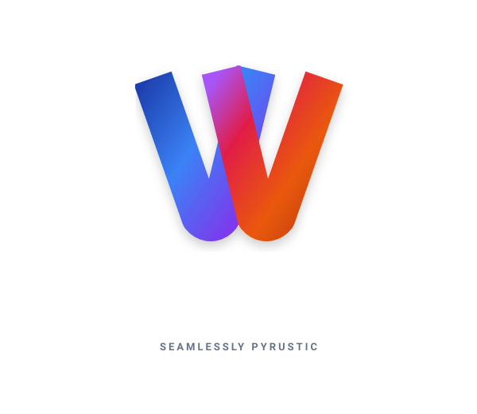

<div align="center">
  
</div>

# Benchmarks

Weft, Peregrine and Granian on the-benchmarker contract, 256 connections.

Measured 2026-09-27 on `192.168.100.100` (`sanctuary3`): Intel i5-8250U,
4 cores / 8 threads, 3.2 GB, Ubuntu 26.04. CPython 3.14.7. `zrk` 2.5.0.
Weft 0.1.0 (release). Peregrine 1.1.7. Granian 2.8.3.

Every run answered every request. No errors, timeouts, or non-2xx.

Peregrine was measured in an earlier session the same day; Weft and Granian
in a later one. Weft’s ASGI and WSGI medians moved by 2% between sessions;
the Weft column below is the later session.

## Requests per second

Median of three 15 s open-loop ramps. Bold is the highest in the row.

| app | Weft | Peregrine | Granian | Weft / Peregrine | Weft / Granian |
|---|---:|---:|---:|---:|---:|
| raw ASGI | 140,570 | **141,791** | 74,026 | 99% | 1.90× |
| raw WSGI | 151,752 | **200,227** | 87,733 | 76% | 1.73× |
| FastAPI 0.141.1 | 34,551 | **36,433** | 23,061 | 95% | 1.50× |

Latency, p50 / p99, milliseconds (zrk coordinated-omission queue time; the
ramp is faster than every server here):

| app | Weft | Peregrine | Granian |
|---|---|---|---|
| raw ASGI | 1,029 / 5,155 | 1,216 / 4,667 | 2,500 / 7,088 |
| raw WSGI | 948 / 6,207 | 851 / 3,540 | 1,758 / 6,195 |
| FastAPI | 3,796 / 9,736 | 3,761 / 9,253 | 4,499 / 10,408 |

Three runs, requests per second:

| app | Weft | Peregrine | Granian |
|---|---|---|---|
| raw ASGI | 141,997 · 140,570 · 120,547 | 138,643 · 141,791 · 142,277 | 79,280 · 74,026 · 73,422 |
| raw WSGI | 152,262 · 142,664 · 151,752 | 173,657 · 200,565 · 200,227 | 87,733 · 86,959 · 88,907 |
| FastAPI | 36,618 · 34,551 · 34,145 | 39,435 · 36,220 · 36,433 | 23,522 · 23,061 · 22,637 |

Raw ASGI: Weft and Peregrine are inside the spread; both about 1.9× Granian.
WSGI: Peregrine is ahead (asyncio-free poller). FastAPI: the framework
dominates; Weft and Peregrine stay close, both about 1.5× Granian.

## Method

The-benchmarker collect command
([web-frameworks](https://github.com/the-benchmarker/web-frameworks) `develop`
at 4bb9eaa):

```
warm-up    zrk -c 50 -d 5s --plain URL
per run    zrk --plain -c 256 -d 15s -m GET --format json -R1000:500000 \
               --interval 1s --timeout 8s --latency URL
```

Ramp 1,000→500,000 req/s over 15 s, keep-alive on. Figure is `achieved_rate`,
median of three runs. Load hits `GET /` on the suite’s three-route contract.
FastAPI 0.141.1 / Starlette 1.7.0 / Pydantic 2.13.5.

Four worker processes. Server on physical cores 0+1 (`0,4,1,5`), zrk on 2+3
(`2,6,3,7`). `127.0.0.1:3000`.

```
FRAMEWORKS="asgi wsgi fastapi" SERVERS="weft peregrine granian" CONNS=256 \
  WORKERS=4 RUNS=3 PIN=0,4,1,5:2,6,3,7 bash bench/vs_peregrine.sh
```

TSV: `bench/results/weft-vs-peregrine-256.tsv`,
`bench/results/weft-vs-granian-256.tsv`.

Not comparable with the site’s published dataset (this machine, 4 workers,
load generator on the same host). The three columns are comparable with
each other.

---

## FreeBSD: 64, 256 and 512 connections

Weft, uvicorn and Granian at the-benchmarker's three concurrency levels.

Measured 2026-11-26 on the same machine (Intel i5-8250U, 4 cores / 8
threads), booted into FreeBSD 15.1. CPython 3.14.10. Weft 0.2.0 (release
build, commit `cfafe1c`). uvicorn 0.54.0 with uvloop and httptools.
Granian 2.8.9, built from source (no FreeBSD wheel). FastAPI 0.165.0 /
Starlette 1.10.0 / Pydantic 2.14.4. `oha` 1.17.0.

Every response was a 200 and every server started. Requests per second,
the mean of the three contract routes (`GET /`, `GET /user/42`,
`POST /user`), each the median of two rounds. Bold is the highest in the
column.

### FastAPI

| server | 64 | 256 | 512 |
|---|---:|---:|---:|
| Weft | **18,603** | **19,577** | **20,026** |
| uvicorn | 14,821 | 15,222 | 15,120 |
| Granian | 14,811 | 15,220 | 14,999 |
| Weft / uvicorn | 1.26× | 1.29× | 1.32× |
| Weft / Granian | 1.26× | 1.29× | 1.34× |

### Raw ASGI

| server | 64 | 256 | 512 |
|---|---:|---:|---:|
| Weft | **90,983** | **112,010** | **112,979** |
| uvicorn | 45,745 | 48,806 | 49,284 |
| Granian | 53,212 | 55,592 | 56,946 |
| Weft / uvicorn | 1.99× | 2.30× | 2.29× |
| Weft / Granian | 1.71× | 2.01× | 1.98× |

Weft is ahead on every route at every level, and its lowest round is above
the others' highest. From 64 to 512 connections Weft gains 8% (FastAPI) and
24% (raw ASGI); uvicorn and Granian stay flat. At 512 connections uvicorn
had 9–254 failed connections in 7 of its 12 runs, beyond the one in-flight
request per connection that every server has cut at the deadline; Weft and
Granian had none.

### Method

The site's shape, with `oha` in place of `zrk` (not packaged for FreeBSD).
Both are closed-loop with keep-alive: each connection sends its next
request when the last one is answered.

```
warm-up    oha --no-tui -m METHOD -c 50 -z 5s URL
per run    oha --no-tui --output-format json -m METHOD -c N -z 15s URL
```

Eight worker processes per server (`$(nproc)`, as on the site), unpinned,
with the load generator on the same host. Intel Speed Shift EPP 0 during
the run. Two rounds, the second in reverse order. Apps:
`bench/apps/tb_fastapi.py`, `bench/apps/tb_asgi.py`.

```
sh bench/freebsd_levels.sh   # OUT=/tmp/levels.jsonl
python bench/levels_summary.py /tmp/levels.jsonl
```

Raw results: `bench/data/freebsd-levels-2026-11-26.jsonl`.

Not comparable with the site's published numbers (different machine and
load generator). The columns are comparable with each other.
