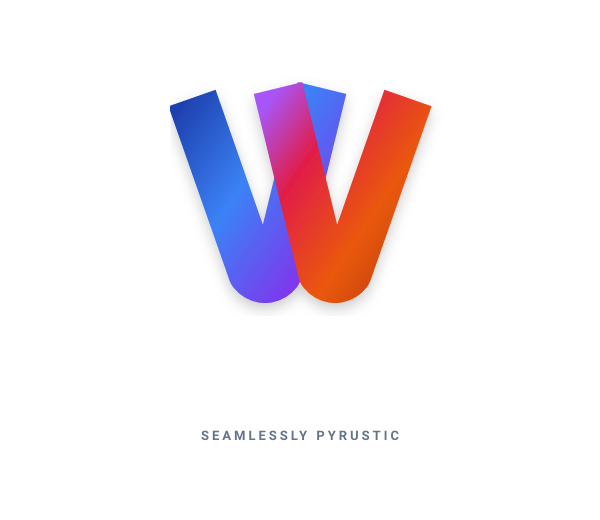

  

# Releases

What changed in each version of Weft, newest first.

**Keeping this file.** A change someone using Weft would notice gets a line
under [Unreleased](#unreleased) in the commit that makes it. When a version
is cut, that section is renamed to the version and its date, and a new
empty Unreleased section goes above it.

Distribution name: `weft-server`. Import package `weft`, CLI `weft`.

---

## Unreleased

---

## 0.2.0 — 2026-11-26

### Added

- FreeBSD: the extension imports and the test suite passes on FreeBSD
  15.1 (it failed to load with "No space available for static Thread
  Local Storage"; mimalloc now uses local-dynamic TLS on the BSDs).
  Benchmarks there in [BENCHMARKS.md](https://github.com/grepjava/weft/blob/master/BENCHMARKS.md#freebsd-64-256-and-512-connections).
- Configuration from a TOML file (`--config PATH`, or `[tool.weft]` in
  `pyproject.toml`) and from `WEFT_*` environment variables, typed from
  the option they set. A flag on the command line beats both.
- `--access-log-file`. The access log is written by a background thread
  and flushed before a worker exits.
- Static files: `Range` requests (206, 416, `If-Range`) and
  `Last-Modified` / `If-Modified-Since`.
- ASGI `http.response.pathsend`.
- `wsgi.input` is native and has `seek`, `tell`, `readinto`, `readable`,
  `seekable`, `getvalue` and `close`.
- `WEFT_EAGER_TASKS=1` starts each HTTP request's task eagerly. Off by
  default: it cost FastAPI about 8% requests/s at saturation.

### Fixed

- Behind trusted proxies, the scheme (`X-Forwarded-Proto`, `Forwarded`
  `proto`) is taken from the same hop as the client address, not always
  the last one.
- WSGI: a `write()` that filled the socket spun forever.
- HTTP/2: stream count and header size are bounded, with a graceful
  GOAWAY, and a flow-control busy-spin is gone.
- HTTP/3: request streams are spawned instead of read inline, and
  malformed WebTransport streams are dropped.
- Brotli streams are finished properly; chunked responses no longer get
  duplicate framing headers or a stray `Vary`.
- TLS read, flush and `close_notify` handling; WebSocket length checks;
  the rate limiter's clock and hashing; metrics alignment.
- Request ids come from a CSPRNG.

### Changed

- Faster request path:
  - one fewer syscall per HTTP/1 request on Unix (raw ASGI +7.8%
    requests/s at saturation);
  - zero-copy reads and per-worker object freelists;
  - a leaner `call_soon` in Weft's event loop;
  - less per-request work on the WSGI path;
  - larger flush batches under high concurrency;
  - a response cache with lock-free hints and LRU eviction.
- On FreeBSD, Weft serves FastAPI at about 1.3× uvicorn and Granian, and
  raw ASGI at 1.7–2.3×, at 64, 256 and 512 connections.

---

## 0.1.1 — 2026-10-23

### Fixed

- Process workers: the first Ctrl+C no longer hangs the supervisor
  (workers are signalled over pipes, not `multiprocessing.Event`; #1,
  thanks @patx). SIGTERM to the supervisor or the thread-worker controller
  now drains gracefully, including `--drain-delay` and lifespan shutdown.
  A worker that outlives SIGTERM is killed and reaped; workers already
  started are stopped when a later one fails to start.
- Unix sockets: every client was reset on accept; they are now served.
- HTTP/2 and HTTP/3: request bodies stream to the app after dispatch
  instead of being buffered first, so early responses and
  `--request-timeout` work, and an oversized HTTP/2 body gets 413. Large
  HTTP/3 uploads to a slow app are no longer cut off. Static files are
  sent whole (they were truncated after 64 KiB). An h2 app gets
  `http.disconnect` when the client leaves after the body was read. A
  cleartext h2 preface split across reads is no longer taken for HTTP/1.
- WSGI: `write()` no longer stalls on HTTP/2 and HTTP/3, and
  `SERVER_PROTOCOL` reports HTTP/2 there. A one-block list response no
  longer sends `Content-Length` twice.
- Response cache: a body that does not match its `Content-Length` is not
  cached; responses are aged by their `Date`; `Accept-Encoding` variants
  no longer leak into each other or evict each other; requests with a
  body skip the cache-hit path (their body was parsed as the next
  request); shared slots are safe when a worker holding one pauses or
  dies.
- Static files: a file that shrinks or fails mid-read resets the stream or
  closes the connection instead of looking complete; a precompressed
  file's ETag comes from that file.

### Changed

- WSGI over HTTP/1 keep-alive sends finished responses with the rest of
  their batch: about 1.25× requests/s at saturation and lower p99 on the
  minimal WSGI benchmark. ASGI unchanged.

---

## 0.1.0 — 2026-09-28

The first PyPI release.

### Added

- ASGI 3.0 HTTP (spec 2.4) on Tokio, driven from `asyncio.select()`. Native
  `send` / `receive` vectorcall objects, a copied prototype scope, interned
  keys, and a pre-completed awaitable when the socket is ready.
- HTTP/1.1: keep-alive, pipelining, chunked transfer both ways, `Expect:
  100-continue`, HEAD/204/304, smuggling checks, header timeouts, a head
  size limit, graceful drain.
- WebSocket: handshake, framing, fragmentation, ping/pong, limits, queue
  backpressure, `permessage-deflate`.
- WSGI (PEP 3333): protocol detection, native environ and `start_response`
  (including `write()`), streamed iterables, `wsgi.file_wrapper`,
  `--wsgi-threads`.
- HTTP/2 over TLS (ALPN `h2`) and cleartext prior knowledge.
- HTTP/3 over QUIC (`--http3`, `--quic-port`) and WebTransport as ASGI
  `webtransport.*`. Incoming streams and datagrams; CONNECT accept/refuse.
  `weft.webtransport.WebTransportSession` and `weft.contrib` (Starlette /
  FastAPI / Django routers, `AltSvcMiddleware`, IETF resumable uploads).
- TLS via rustls: `--tls-cert` / `--tls-key`, SNI when repeated, `--hsts`,
  `--redirect-http`.
- Static files (`--static-dir`), compression, shared response cache
  (`--cache-size`).
- Access log (text or JSON), `--health-check-path`, `--drain-delay`,
  `--max-connections`, `--forwarded-allow-ips`, `--request-id`,
  `--trace-context`, `--request-start-header`, `--rate-limit`, unix
  sockets, `--reload` and `SIGHUP` rolling restart, `--venv`,
  `--no-lifespan`.
- Prometheus on `--metrics-port` / `--metrics-host`.
- Process workers and `--worker-mode thread` on free-threaded CPython
  3.14t. `Py_mod_gil = Py_MOD_GIL_NOT_USED`.

### Known

- ACME is not implemented; leave issuance to Caddy.
- Raw WSGI is slower than Peregrine's asyncio-free poller (76% at 256
  connections on the contract). Raw ASGI and FastAPI match Peregrine and
  are 1.5–1.9× Granian 2.8.3. [BENCHMARKS.md](https://github.com/grepjava/weft/blob/master/BENCHMARKS.md).

---

## Publishing to PyPI

Wheels are built and uploaded by `.github/workflows/release.yml` on a
`v*` tag. Version in `Cargo.toml` must match the tag (`v0.1.0` → `0.1.0`).

1. On [PyPI](https://pypi.org/manage/account/publishing/), add a **pending
   trusted publisher** for `weft-server`:
   - Owner: `grepjava`
   - Repository: `weft`
   - Workflow name: `release.yml`
   - Environment name: `release`
2. `git tag v0.1.0 && git push origin v0.1.0`

The first upload creates the project. Later tags reuse the same publisher.
